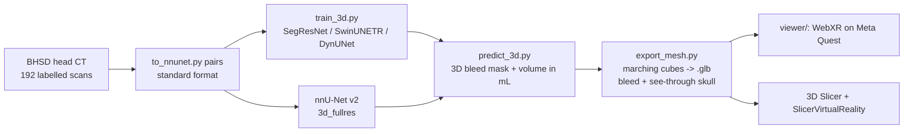

# Brain Clot Analysis: 3D branch (3D models, 3D rendering, VR)

> **You are on the `3d` branch.** The code is ready, but it **needs a larger GPU** than a free Colab T4 for most models (see the hardware table below).
> To run something today on a free Colab T4, use the **[`master` branch (2D)](../../tree/master)**.
>
> ⚠️ Research and education only. Not for clinical use.

## Two branches: 2D and 3D

| | **`master`: 2D** | **`3d` (this branch): 3D** |
|---|---|---|
| What it does | Segments the bleed slice by slice, then stacks the slices to measure the whole scan | Segments the **whole CT volume** at once, exports a **3D model**, and shows it in **VR** |
| Models | U-Net++ on a pretrained EfficientNet-B3 | SegResNet, SwinUNETR, DynUNet (MONAI), plus nnU-Net v2 |
| Runs on | Free Google Colab T4 | 12–16 GB GPU minimum; 24 GB+ recommended |
| Status | Ready to run | Code ready; run when the hardware is available |

## Hardware needed

| Job | Minimum | Comfortable | Example cards |
|---|---|---|---|
| Running a trained model | 4 GB GPU | 8 GB | RTX 3050 and up; CPU works but is slow |
| SegResNet / DynUNet training | 12 GB, batch 1, mixed precision | 16–24 GB | Colab T4 (slow), RTX 3060 12 GB, RTX 4090 |
| SwinUNETR training | 16 GB, batch 1, gradient checkpointing | 24–40 GB | RTX 3090/4090, A100 (Colab Pro) |
| nnU-Net v2 3d_fullres training | 10 GB (11 GB guaranteed) | 24 GB | RTX 2080 Ti / 3080 / 3090 / 4090 |
| CPU and RAM | 6 cores, 32 GB RAM | 16 cores, 64 GB | data augmentation is CPU-heavy |
| VR via 3D Slicer | Windows PC with a VR-ready GPU (check Meta's Quest Link spec) | RTX 3070+ | plus a Meta Quest and a Link cable or Air Link |
| VR via the WebXR viewer | no PC GPU | n/a | the Quest renders the model itself |

Head-CT bleed data (BHSD) has thick slices, so the code uses flat patches (for example 160×160×32). With these, SegResNet and nnU-Net can train on a 16 GB T4, slowly.

## Pipeline



- **Bleed types:** BHSD's 5 bleed types are kept as separate classes, and Dice is reported per type.
- **Patches and spacing:** the data is resampled to the dataset's median voxel size, and thick-slice CT automatically gets flat patches.
- **Evaluation:** a fixed 70/15/15 split by scan (`split.json`), sliding-window inference on whole volumes, and Dice per class on the held-out scans.
- **Other tasks:** the same scripts also handle brain tumour (BraTS) and ischaemic stroke (ISLES 2022) with `to_nnunet.py brats` and `to_nnunet.py isles22`.

## Models

| Model | Type | Default patch | Notes |
|---|---|---|---|
| `segresnet` | residual 3D CNN encoder-decoder | 128³, or flat for CT | best accuracy per GB of GPU memory |
| `swinunetr` | Swin-transformer encoder + CNN decoder | 96³, or flat for CT | most modern; most memory |
| `dynunet` | nnU-Net-style 3D U-Net | 128³, or flat for CT | strides adapt to thick slices |
| nnU-Net v2 | self-configuring 3D U-Net | automatic | strongest baseline |

## Run it

Colab: open `colab_train_3d.ipynb` (`TASK = "bhsd"` is the default) and choose an A100, or a T4 for SegResNet only.

Command line:
```bash
pip install -r requirements.txt
python to_nnunet.py pairs --src data/bhsd --out nnUNet_raw --id 503 --name BHSD --channel CT \
       --label-names bleed_1,bleed_2,bleed_3,bleed_4,bleed_5
python train_3d.py --dataset nnUNet_raw/Dataset503_BHSD --model segresnet --out runs/bhsd_segresnet
python predict_3d.py --ckpt runs/bhsd_segresnet/best.pt --case <scan id> --out pred/scan.nii.gz
python export_mesh.py --labels pred/scan.nii.gz --preset bhsd --context <ct>.nii.gz --context-mode ct-skull --out scan.glb
```

nnU-Net baseline on the same converted data:
```bash
pip install nnunetv2
export nnUNet_raw=$PWD/nnUNet_raw nnUNet_preprocessed=$PWD/nnUNet_preprocessed nnUNet_results=$PWD/nnUNet_results
nnUNetv2_plan_and_preprocess -d 503 --verify_dataset_integrity
nnUNetv2_train 503 3d_fullres 0
```

Check the BHSD README for which label number is which bleed type.

## 3D and VR viewing

- `export_mesh.py` turns the predicted mask into a `.glb` 3D model:
  - each bleed type is smoothed and meshed in real millimetres;
  - the skull (bone > 300 HU) is added as a see-through surface;
  - the bleed volume in mL is saved next to the model.
- **WebXR viewer (no PC needed):**
  1. Host `viewer/` on any HTTPS site, for example GitHub Pages (needs a public repo).
  2. Open it in the Meta Quest browser and tap **Enter VR** or **Passthrough**.
  3. Load the `.glb`. Hold the trigger to grab and turn it; press grip to show or hide the skull.
- **3D Slicer (Windows):**
  1. Install the SlicerVirtualReality extension.
  2. Load the CT and the predicted mask, then click the VR button. Works with a Meta Quest over Quest Link.

## Files

| File | Purpose |
|---|---|
| `to_nnunet.py` | Converters: `pairs` (BHSD / any CT mask pairs), `brats`, `isles22` |
| `data_3d.py` | Dataset reader, label classes/regions, MONAI transforms, split by scan |
| `models_3d.py` | SegResNet, SwinUNETR, DynUNet |
| `train_3d.py` | Training, validation, early stopping, resume after a disconnect, test Dice |
| `predict_3d.py` | One scan → mask on the original grid + volumes in mL |
| `export_mesh.py` | Mask → smoothed 3D meshes → `.glb` (tested on synthetic volumes) |
| `viewer/` | three.js WebXR viewer + synthetic demo model (not patient data) |
| `colab_train_3d.ipynb` | Everything in Colab |

## Data

BHSD: Wu et al., *BHSD: A 3D Multi-Class Brain Hemorrhage Segmentation Dataset*, MLMI 2023, [arXiv 2308.11298](https://arxiv.org/abs/2308.11298).
Never commit scans or masks to this repo.
