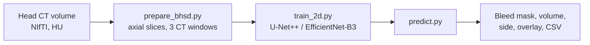

# Brain haemorrhage segmentation on head CT

This project finds bleeding (a clot or haemorrhage) on head CT scans and measures it: the volume in millilitres, which side of the brain it is on, and how many slices it spans. The same code is set up for edema and midline shift once labelled data for those is available.

This is a research and teaching project. It has not been validated for clinical use.

Every experiment is recorded in [RESEARCH_LOG.md](RESEARCH_LOG.md), and the raw outputs are in [results/](results/).

## Results so far

Full training ran on 26 November on an L4 GPU and stopped early after 15 epochs without improvement. On the 30 held-out test scans, never seen in training or model selection:

| Measure | Quick test (2 epochs) | Full training |
|---|---|---|
| 3D Dice per scan | 0.550 mean, 0.659 median | **0.628 mean, 0.756 median** |
| Bleed volume error | 14.8 mL, r = 0.83 | **12.2 mL, r = 0.90** |
| Slices with bleeding that were found (sensitivity) | 0.874 | 0.756 |
| Bleed-free slices correctly left empty (specificity) | 0.779 | **0.965** |

The gap between mean and median Dice means most scans are segmented well and a few small or faint bleeds pull the mean down. Full training traded some slice sensitivity for far fewer false alarms. Raising sensitivity without losing that specificity is the next thing to work on (see the research log).

## Two branches

| | `master` (this branch): 2D | `3d` branch |
|---|---|---|
| Approach | Segments each slice, then stacks the slices to measure the whole scan | Segments the whole CT volume at once, exports a 3D model and shows it in VR |
| Models | U-Net++ on an ImageNet-pretrained EfficientNet-B3 | SegResNet, SwinUNETR and DynUNet (MONAI), plus nnU-Net |
| Hardware | A free Colab T4 is enough | A GPU with at least 12–16 GB; 24 GB or more is comfortable |
| Status | Training | Code ready, to be run on an A100 |

Hardware in more detail:

| Job | 2D (`master`) | 3D (`3d` branch) |
|---|---|---|
| Training memory | 6–10 GB (batch 16, 256 px) | SegResNet 12–16 GB; nnU-Net 10 GB or more; SwinUNETR 16 GB minimum, 24–40 GB comfortable |
| Example GPUs | Colab T4 or L4, RTX 3060 or better | RTX 3090/4090, A100 |
| System RAM | About 2–4 GB | 32 GB recommended |
| Training time | About 45 minutes on an L4 | Hours, depending on the model |
| Running a trained model | Any GPU, or a CPU at about a second per slice | A 4–8 GB GPU |
| Viewing results | Overlay images, 3D Slicer | 3D Slicer, or the WebXR viewer on a Meta Quest |

## Data

The model is trained on BHSD, the Brain Hemorrhage Segmentation Dataset (Wu et al., MLMI 2023, [arXiv 2308.11298](https://arxiv.org/abs/2308.11298)). It has 192 non-contrast head CT scans in which the bleeding is outlined pixel by pixel, across five bleed types. The scans come from the RSNA 2019 Brain CT Hemorrhage Challenge. The notebook downloads the dataset (`label_192.zip` on Hugging Face). Please cite the paper if you use it, and never commit the data to this repository.

The scans are split 70/15/15 by scan (134 training, 28 validation, 30 test), so every slice of a scan stays in one part. This branch merges the five bleed types into one "bleed" label; the 3D branch can keep them apart.

## How it works



`prepare_bhsd.py` reorients each scan, cuts it into axial slices and resizes them to 256 × 256. Each slice becomes three images, one per CT window, the same views a radiologist switches between. Three channels also match what ImageNet-pretrained encoders expect.

| Channel | Window (level / width, HU) | Shows |
|---|---|---|
| 1 | Brain, 40 / 80 | Brain tissue and most bleeds |
| 2 | Subdural, 80 / 200 | Thin bleeds against the skull |
| 3 | Bone, 600 / 2800 | The skull and head outline, used to find the midline |

`train_2d.py` trains a U-Net++ decoder on an EfficientNet-B3 encoder pretrained on ImageNet:

| Setting | Value |
|---|---|
| Sampling | Each epoch uses every training slice with bleeding plus the same number of random slices without |
| Loss | Binary cross-entropy plus soft Dice per slice |
| Optimiser | AdamW, one-cycle learning rate peaking at 3e-4, up to 60 epochs, early stopping after 15 without improvement |
| Augmentation | Flips, rotation up to 15°, zoom 0.85–1.15, shifts up to 8%, contrast and brightness |
| Model selection | The epoch with the best 3D Dice on the validation scans |
| Prediction | Each slice is averaged with its mirrored prediction; specks under 10 pixels are removed |

The test results are reported per scan: 3D Dice (all slices stacked), the error between predicted and expert bleed volume in mL with its correlation, and slice-level sensitivity and specificity.

`predict.py` runs the model on a full scan and reports these measurements:

| Output | How it is calculated |
|---|---|
| Bleed volume | Predicted pixels × real pixel area × slice thickness, from the scan header |
| Side | Bleed pixels left and right of the head's centre line, in radiological convention; "both sides" when each side has more than 20% |
| Midline shift | `measurements.midline_shift` needs a mask of the midline structures, which is waiting for labelled data |
| Edema | Same model and code, waiting for edema masks |

The model reports measurements only. It does not produce diagnoses, symptoms or severity grades.

## Running it

In Google Colab, open `colab_clot_2d.ipynb` (*File → Open notebook → GitHub*, branch `master`), choose a GPU runtime and run the sections in order.

From the command line, after installing PyTorch with CUDA:

```bash
pip install -r requirements.txt
python prepare_bhsd.py --src data/bhsd --out data/bhsd_256
python train_2d.py --data data/bhsd_256 --out models/clot
python predict.py --ckpt models/clot/clot_best.pt --ct scan.nii.gz --out predictions/
```

## Files

| File | Purpose |
|---|---|
| `data_ct.py` | Reads and reorients NIfTI scans, applies CT windows, cuts slices, splits by scan |
| `prepare_bhsd.py` | Turns BHSD (or any matching image and mask folders) into compact slice files |
| `model.py` | The U-Net++ model, checkpoint loading and prediction with flip averaging |
| `train_2d.py` | Training, validation by 3D Dice, test metrics |
| `predict.py` | One scan in; bleed mask, volume, side, overlay image and CSV out |
| `measurements.py` | Head outline, centre line, side, area and the midline-shift helper |
| `colab_clot_2d.ipynb` | The whole workflow in Google Colab |
| `results/` | Raw outputs from every run |
| `RESEARCH_LOG.md` | What was tried, what happened and what came next |

## Limitations

BHSD has 192 labelled scans from one challenge source, so performance on other hospitals' scanners is unknown. The slices are thick, so volumes measured slice by slice are coarser than a true 3D measurement. Edema and midline shift have not been trained or validated yet.
