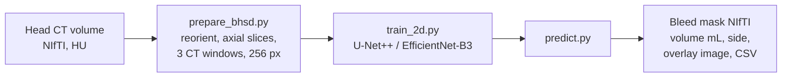

# Brain Clot, Edema and Midline-Shift Analysis on Head CT

Finds **bleeding (clot / haemorrhage)** on head-CT scans and measures it: **volume in mL, which side, how many slices**.
Edema and midline-shift models use the same code once suitable labelled data is available.

> ⚠️ Research and education only. Not for clinical use.

## Two branches: 2D and 3D

| | **`master` (this branch): 2D** | **`3d` branch: 3D** |
|---|---|---|
| What it does | Segments the bleed slice by slice, then stacks the slices to measure the whole scan | Segments the whole CT volume at once; exports a 3D model and shows it in VR |
| Models | U-Net++ on an ImageNet-pretrained EfficientNet-B3 | SegResNet, SwinUNETR, DynUNet (MONAI), plus nnU-Net |
| Runs on | **Free Google Colab T4** (or any NVIDIA GPU with 8 GB or more) | **Needs a bigger GPU**: 12–16 GB minimum, 24 GB+ recommended (see table) |
| Status | **Ready to run**: [`colab_clot_2d.ipynb`](colab_clot_2d.ipynb) | Code ready; run when the hardware is available |

### Hardware needed

| Job | 2D (`master`) | 3D (`3d` branch) |
|---|---|---|
| Training GPU memory | 6–10 GB (batch 16, 256 px) | SegResNet 12–16 GB; nnU-Net 10 GB or more; SwinUNETR 16 GB minimum, 24–40 GB comfortable |
| Suitable GPUs | Colab T4 (free), RTX 3060 or better | RTX 3090/4090 (24 GB), A100 (Colab Pro); a T4 only for SegResNet and nnU-Net, slowly |
| System RAM | about 2–4 GB | 32 GB recommended |
| Training time | about 1.5–2.5 h on a T4 (estimate) | many hours to days, depending on model and GPU |
| Running a trained model | any GPU, or CPU (about 1 s per slice) | 4–8 GB GPU |
| Viewing results | overlay images, 3D Slicer | 3D Slicer; WebXR viewer on a Meta Quest (no PC GPU needed) |

## Data: BHSD

**BHSD** (Brain Hemorrhage Segmentation Dataset; Wu et al., MLMI 2023, [arXiv 2308.11298](https://arxiv.org/abs/2308.11298)):
192 non-contrast head-CT scans with pixel-level bleed outlines across 5 bleed types, built from the RSNA 2019 Brain CT Hemorrhage Challenge.
It is downloaded automatically in the notebook (`label_192.zip` on Hugging Face). Cite the paper when you use it, and never commit the data to this repo.

This branch merges the 5 bleed types into one "bleed" mask. The 3D branch can also keep them apart.

## Pipeline (2D)



**Input = 3 CT windows per slice**, like a radiologist switching windows. This also matches ImageNet-pretrained encoders:

| Channel | Window (level / width, HU) | Shows |
|---|---|---|
| 1 | brain 40 / 80 | brain tissue and most bleeds |
| 2 | subdural 80 / 200 | thin bleeds next to the skull |
| 3 | bone 600 / 2800 | skull and head outline (used to find the midline) |

## Model and training

| Setting | Value |
|---|---|
| Model | U-Net++ decoder on an EfficientNet-B3 encoder pretrained on ImageNet (segmentation-models-pytorch) |
| Split | **70 / 15 / 15 by scan**: every slice of a scan is in exactly one part |
| Sampling | Every epoch: all training slices with bleeding plus the same number of random slices without |
| Loss | BCE + per-slice soft Dice |
| Optimiser | AdamW, one-cycle learning rate up to 3e-4, up to 60 epochs, early stopping (patience 15) |
| Augmentation | Flip, rotation ±15°, zoom 0.85–1.15, shift ±8 %, contrast and brightness |
| Prediction | Average with the mirrored slice (test-time augmentation); specks under 10 pixels removed |
| Model selection | Best **3D Dice** on the validation scans |

### Reported on the held-out test scans
- **3D Dice** per scan (all slices stacked): mean and median
- **Bleed volume** predicted vs expert: mean absolute error in mL and correlation
- **Slice detection**: sensitivity and specificity for "this slice shows bleeding"

Results will be added here after the first full run.

## Measurements (`measurements.py`, `predict.py`)

| Output | Method |
|---|---|
| Bleed volume | Predicted pixels × real pixel area × slice thickness, from the NIfTI header (mL) |
| Side | Bleed pixels left/right of the head's centre line, in **radiological convention**; "both sides" if each side has more than 20 % |
| Midline shift | `measurements.midline_shift` needs a midline-structure mask: **awaiting labelled data** |
| Edema | Same model and code with edema masks: **awaiting labelled data** |

No symptoms, diagnoses or severity grades are produced.

## Run it

**Colab:** open `colab_clot_2d.ipynb` → *Runtime → T4 GPU* → run the cells in order.

**Command line:**
```bash
pip install -r requirements.txt          # after installing PyTorch with CUDA
python prepare_bhsd.py --src data/bhsd --out data/bhsd_256
python train_2d.py --data data/bhsd_256 --out models/clot
python predict.py --ckpt models/clot/clot_best.pt --ct scan.nii.gz --out predictions/
```

## Files

| File | Purpose |
|---|---|
| `data_ct.py` | NIfTI reading and reorientation, CT windows, slice extraction, split by scan |
| `prepare_bhsd.py` | BHSD (or any image/mask folder pair) → compact `.npz` slice files |
| `model.py` | U-Net++ / EfficientNet-B3 model, checkpoint loading, prediction with flip TTA |
| `train_2d.py` | Training, validation by 3D Dice, test metrics |
| `predict.py` | One CT scan → bleed mask, volume, side, overlay, CSV |
| `measurements.py` | Head outline, centre line, side, area, midline-shift helper |
| `colab_clot_2d.ipynb` | Everything in Google Colab |

## Limitations

- BHSD has 192 labelled scans from one challenge source; results on other hospitals' scanners are unknown.
- Thick CT slices: the volume is estimated from slices, which is coarser than true 3D.
- Edema and midline shift are not yet trained or validated.
