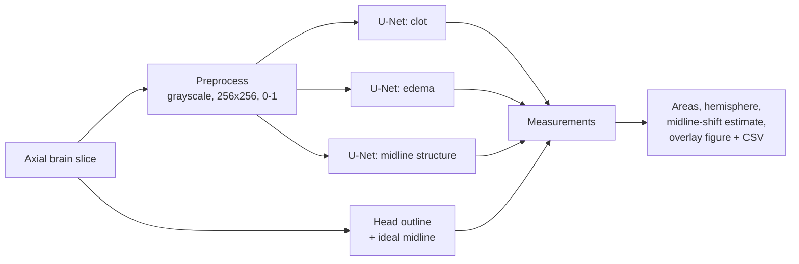
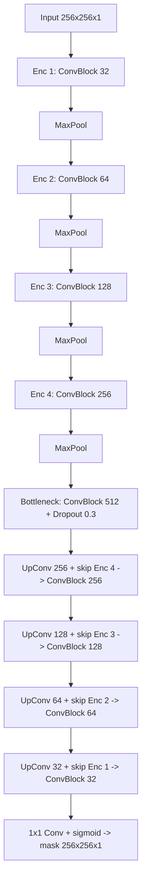

# Brain Clot, Edema and Midline-Shift Analysis with U-Net

A research pipeline that segments **clot**, **edema** and the **midline structure** on 2D axial brain slices with three U-Net models, then reports **lesion areas, affected hemisphere and an estimate of midline shift**.

> **Status: architecture and pipeline complete — awaiting suitable annotated data for training and validation.**
> The code is ready to train. A prototype was trained on a small public dataset, but its results are **not reported** because that run used an image-level split and had no held-out test set. The models will be retrained and evaluated once a dataset with the right annotations is available (see [Data needed](#data-needed)).
>
> ⚠️ Research and education only. Not for clinical use.

---

## Pipeline



Three separate binary segmentation models share the same architecture, so each can be trained and improved on its own data.

## Model architecture (each of the three U-Nets)



**ConvBlock** = [3×3 Conv (no bias) → BatchNorm → ReLU] × 2

| Stage | Output shape | Parameters |
|---|---|---|
| Input | 256 × 256 × 1 | 0 |
| Encoder 1–4 (32 → 256 filters, max-pool after each) | 256² × 32 → 16² × 256 | 1,174,560 |
| Bottleneck (512 filters, dropout 0.3) | 16 × 16 × 512 | 3,543,040 |
| Decoder 4–1 (2×2 transposed conv + skip + ConvBlock) | 32² × 256 → 256² × 32 | 3,050,720 |
| Output (1×1 conv, sigmoid) | 256 × 256 × 1 | 33 |
| **Total** | | **≈ 7.77 M** (5,888 non-trainable BatchNorm) |

### Why these choices

| Choice | Reason |
|---|---|
| U-Net with skip connections | Keeps fine boundary detail, which matters for small lesions |
| 4 levels, 16 × 16 bottleneck | Large receptive field so the midline model sees the whole brain width |
| Batch normalisation | Stable training on small medical datasets |
| **Dice + BCE loss** | Plain BCE lets small lesions collapse to "all background" |
| Dropout + augmentation + early stopping | Limits overfitting on limited data |

## Training setup (`train_unet.py`)

| Setting | Value |
|---|---|
| Split | 70 / 15 / 15 train / validation / **held-out test**; `--patient-regex` keeps each patient in one split |
| Duplicates | Exact duplicate images removed before splitting |
| Optimiser | Adam, learning rate 1e-4, halved on plateau |
| Epochs | Up to 300, early stopping (patience 30) on validation Dice; best model saved |
| Augmentation | Left–right flip (image + mask), brightness ±0.1, contrast 0.9–1.1 |
| Reported metric | **Per-image Dice on the held-out test set** |

```bash
pip install -r requirements.txt
python train_unet.py --images images/ --masks masks/ --target clot --patient-regex '^(P\d+)_'
```

## Measurements (`measurements.py`)

| Output | Method |
|---|---|
| Lesion area | Pixel count; **mm² only when real pixel spacing is given** (`--pixel-spacing` from DICOM/NIfTI) |
| Affected side | Majority side of the lesion relative to the head midline, in **radiological convention** (image left = patient's right) |
| Midline shift | **Distance** (px or mm): largest horizontal offset between the predicted midline structure and the ideal midline (centre of the head outline) |
| Lesion burden | % of head area covered by clot **or** edema (overlap counted once) |

No symptoms, diagnoses or severity grades are produced.

```bash
python predict.py --images DeepLearningModelsh5files/new_images/new_images \
  --clot-model <clot model> --edema-model <edema model> --midline-model <midline model> \
  --pixel-spacing 0.45
```

## Data needed

To train and validate properly, the pipeline needs:

1. **Pixel-level masks** for clot/haemorrhage and edema
2. **Midline-shift ground truth** (expert measurements in mm, or midline annotations)
3. **Patient IDs**, so slices from one patient stay in one split
4. **Pixel spacing** (DICOM or NIfTI), so areas and shift can be reported in mm

Candidate public datasets being evaluated (head CT):

| Dataset | What it offers |
|---|---|
| CQ500 | Scan-level radiologist labels for haemorrhage types, **midline shift** and mass effect (three readers) |
| Seg-CQ500 | Haemorrhage segmentation masks for 51 CQ500 scans |
| PhysioNet CT-ICH | 82 CT scans with haemorrhage masks |
| INSTANCE 2022 | 130 CT scans with haemorrhage masks |
| BHSD | 192 3D CT volumes with pixel-level multi-class haemorrhage masks |

Licences and access conditions differ per dataset and will be checked before use.

## Repository structure

| File | Purpose |
|---|---|
| `train_unet.py` | Train one U-Net (`--target clot`, `edema` or `midline`) |
| `predict.py` | Run the three models; save overlays and `measurements.csv` |
| `measurements.py` | Areas, hemisphere side, midline-shift estimate (NumPy/OpenCV, testable on its own) |
| `DeepLearningModelsh5files/` | Prototype `.h5` weights from an earlier run and sample slices from a public dataset |
| `requirements.txt` | Python dependencies |

## Known limitations

- 2D slices only; no 3D volume analysis yet.
- Midline shift is an approximation and has **not** been validated against expert measurements.
- Head outline uses a simple intensity threshold and may fail on unusual images.
- The prototype `.h5` weights were trained with an earlier script (BCE loss, image-level split, no test set). They are kept for reference only; no performance is claimed for them.

## Roadmap

- [ ] Train and evaluate on a public dataset with masks and patient IDs
- [ ] Validate midline-shift estimates against expert labels (e.g. CQ500)
- [ ] 3D volumes with real voxel spacing
- [ ] PyTorch / MONAI version
